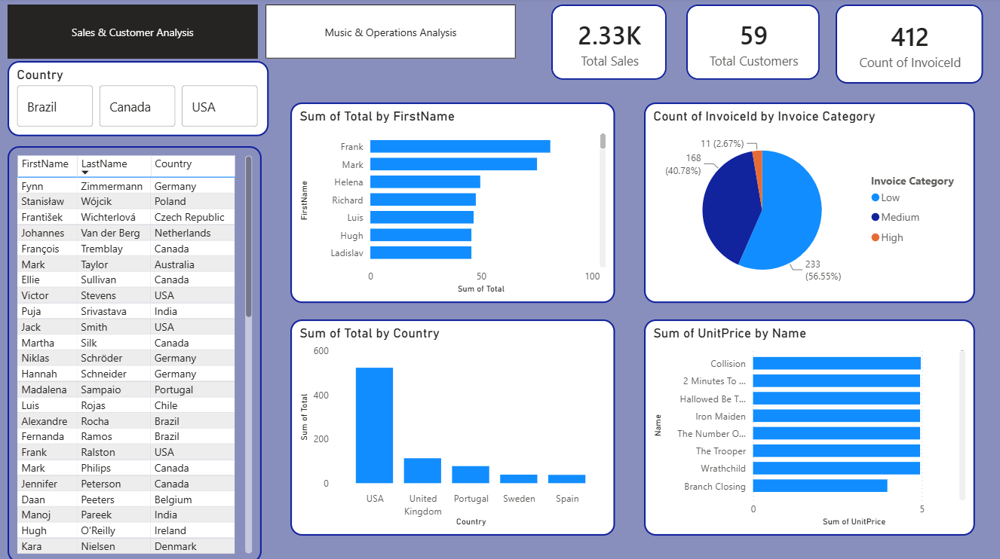
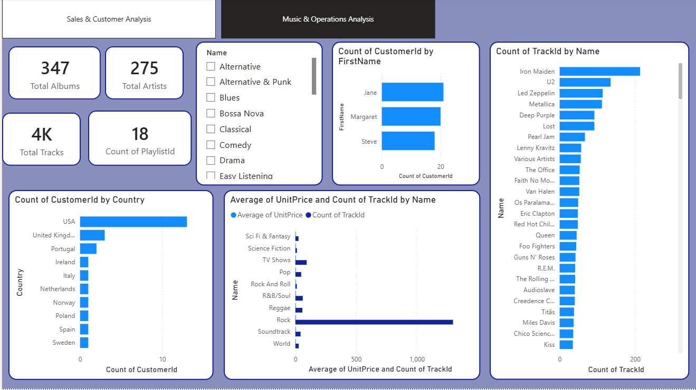

# 🎵 Chinook Music Store: Sales, Customer & Music Analytics


> An end-to-end analysis of the Chinook digital music store: 11 business questions answered in T-SQL, then presented in a 2-page interactive Power BI dashboard covering sales, customers, and the music catalog.

---

## 📌 Table of Contents

- [Project Overview](#-project-overview)
- [Dataset](#-dataset)
- [Tools & Technologies](#-tools--technologies)
- [Business Questions & SQL Analysis](#-business-questions--sql-analysis)
- [Sample Queries](#-sample-queries)
- [Dashboard](#-dashboard)
- [Key Insights](#-key-insights)
- [Project Structure](#-project-structure)
- [How to Run](#-how-to-run)
- [Skills Demonstrated](#-skills-demonstrated)
- [Author](#-author)

---

## 📖 Project Overview

Chinook is a sample database that models a digital media store (similar to iTunes). It stores information about artists, albums, tracks, customers, employees, and invoices.

This project explores that data to understand **where revenue comes from, who the most valuable customers are, how the catalog is structured, and how the support team is distributed**. The work has two parts:

1. **SQL analysis:** 11 queries in T-SQL using joins, CTEs, window functions, subqueries, and conditional logic.
2. **Power BI dashboard:** two interactive pages that turn the results into clear KPIs and visuals.

---

## 🗂 Dataset

**Source:** [Chinook Database](https://github.com/lerocha/chinook-database)

The database contains **11 tables**: `Artist`, `Album`, `Track`, `Genre`, `MediaType`, `Playlist`, `PlaylistTrack`, `Customer`, `Employee`, `Invoice`, and `InvoiceLine`.

| Metric | Value |
|--------|-------|
| Artists | 275 |
| Albums | 347 |
| Tracks | ~3.5K |
| Playlists | 18 |
| Customers | 59 |
| Invoices | 412 |
| Total sales | ≈ $2.33K |

---

## 🛠 Tools & Technologies

- **Database:** Microsoft SQL Server (T-SQL)
- **Visualization:** Power BI Desktop
- **Version Control:** Git & GitHub

---

## ❓ Business Questions & SQL Analysis

All queries are in [`sql/project.sql`](sql/project.sql).

| # | Business Question | SQL Concepts |
|---|-------------------|--------------|
| 1 | List every track with its album title, including tracks with no album | `LEFT JOIN` |
| 2 | Which genres have more than 10 tracks, and what is their average track price? | `GROUP BY`, `HAVING`, `AVG` |
| 3 | Which customers have spent more than $100 in total? | `CTE`, `CONCAT_WS`, `JOIN` |
| 4 | Which countries generate the highest sales revenue? | `JOIN`, `SUM`, `ORDER BY` |
| 5 | Which employees support the largest number of customers? | `JOIN`, `COUNT`, `GROUP BY` |
| 6 | How can invoices be categorized as High, Medium, or Low? | `CASE WHEN` |
| 7 | Which unique countries do customers come from? | `DISTINCT` |
| 8 | Which customers are located in the USA, Canada, or Brazil? | `IN` |
| 9 | Which tracks are priced above the average track price? | Subquery |
| 10 | Which customers have first names starting with "A"? | `LIKE` |
| 11 | Rank customers by total spending | `CTE`, `RANK() OVER` |

---

## 💻 Sample Queries

### Customers who spent more than $100

```sql
WITH CustomerSpending AS (
    SELECT CustomerId, SUM(Total) AS Total_Spending
    FROM Invoice
    GROUP BY CustomerId
)
SELECT CONCAT_WS(' ', c.FirstName, c.LastName) AS Full_Name,
       cs.Total_Spending
FROM Customer c
JOIN CustomerSpending cs ON c.CustomerId = cs.CustomerId
WHERE cs.Total_Spending > 100;
```

### Invoice categorization

```sql
SELECT InvoiceId, Total,
       CASE
           WHEN Total >= 10 THEN 'High'
           WHEN Total >= 5  THEN 'Medium'
           ELSE 'Low'
       END AS InvoiceCategory
FROM Invoice;
```

### Customer ranking by spending (window function)

```sql
WITH CustomerSpending AS (
    SELECT CustomerId, SUM(Total) AS Total_Spending
    FROM Invoice
    GROUP BY CustomerId
)
SELECT CONCAT_WS(' ', c.FirstName, c.LastName) AS Full_Name,
       cs.Total_Spending,
       RANK() OVER (ORDER BY cs.Total_Spending DESC) AS Spending_Rank
FROM Customer c
JOIN CustomerSpending cs ON c.CustomerId = cs.CustomerId
ORDER BY Spending_Rank;
```

---

## 📊 Dashboard

The Power BI report has **two pages**.

### Page 1: Sales & Customer Analysis

KPIs for total sales, total customers, and invoice count, plus revenue by country, spending by customer, an invoice-category breakdown, and a country slicer (Brazil / Canada / USA).



### Page 2: Music & Operations Analysis

Catalog KPIs (albums, artists, tracks, playlists), a genre slicer, tracks per artist, tracks and average price by genre, and customers by country.



---

## 💡 Key Insights

- 🌍 **The USA is the dominant market.** It has the most customers and generates several times more revenue than the next country (the UK), followed by Portugal, Sweden, and Spain.
- 🧾 **Most invoices are small.** Of 412 invoices, about 56.6% are *Low* (under $5), 40.8% are *Medium* ($5 to $10), and only 2.7% (11 invoices) are *High* ($10 or more).
- 🎸 **Rock dominates the catalog**, with roughly 1,300 tracks, far ahead of any other genre.
- 🎤 **Iron Maiden has the most tracks** of any artist, followed by U2, Led Zeppelin, Metallica, and Deep Purple.
- 💲 **Track prices are uniform.** Most tracks sit at about $1 (TV shows are priced higher), so revenue is driven by volume rather than price differences.

### Recommendations

- Prioritize marketing and promotions in the USA while testing growth campaigns in smaller markets such as Portugal, Sweden, and Spain.
- Raise average order value through bundles or album-level offers, since most invoices fall in the Low category.
- Add loyalty offers for top-spending customers identified by the ranking query.

---

## 📁 Project Structure

```
chinook-project/
│
├── sql/
│   └── project.sql
├── dashboard/
│   └── chinook_dashboard.pbix
├── images/
│   ├── dashboard_sales_customers.png
│   └── dashboard_music_operations.png
└── README.md
```

---

## ▶️ How to Run

```bash
# 1. Clone the repository
git clone https://github.com/elhammohammed7777-rgb/chinook-project.git
```

1. Install the Chinook database in SQL Server using the official script from the [dataset source](https://github.com/lerocha/chinook-database).
2. Open `sql/project.sql` in SQL Server Management Studio and run the queries (the script starts with `USE Chinook`).
3. Open `dashboard/chinook_dashboard.pbix` in Power BI Desktop and refresh the data source to point to your SQL Server instance.

---

## 🎯 Skills Demonstrated

- T-SQL: joins, aggregations, `HAVING`, CTEs, subqueries, `CASE`, `LIKE`, `IN`, window functions (`RANK`)
- Relational data modeling and reading table relationships
- KPI design and interactive dashboards in Power BI (slicers, bar charts, pie charts, tables)
- Turning data into business insights and recommendations

---

## 👩‍💻 Author

**Elham Mohammed**
Data Analyst | SQL • Power BI • Excel

- 💼 [LinkedIn](https://linkedin.com/in/elham-mohammed-em7)
- 🐙 [GitHub](https://github.com/elhammohammed7777-rgb)
- 📧 elhammohammed7777@gmail.com

---

⭐ If you found this project useful, feel free to star the repo!
